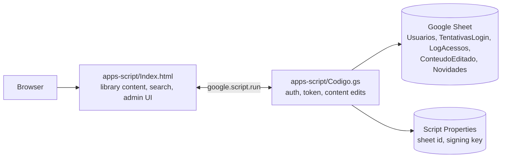
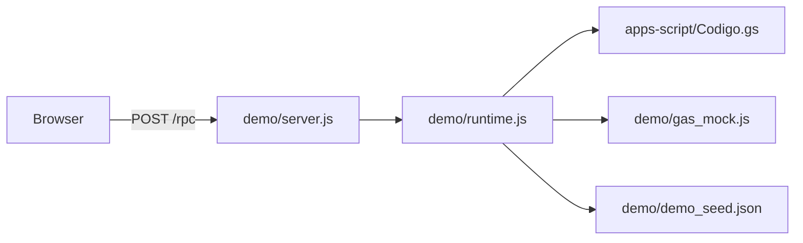

# Portal da Qualidade

A searchable operational library for a customer service team: quality checklists, call and chat scripts, and reference material for six departments, with role based access and in-app content administration. The front end and back end both run on Google Apps Script, and a Google Sheet holds the accounts and the content edits.

This is a sanitized public copy. The original content (scripts, internal policies, real names, queue names, logos, partner banks) was removed and replaced by neutral, plausible demonstration content written for this repository. No real data is included.

## The problem

Supervisors and auditors kept the quality criteria, the service scripts and the "which queue do I transfer to" tables in slide decks, PDFs and text files. Agents had to hunt through them during a call, auditors scored against copies that could be out of date, and nobody was told when something changed.

The portal puts all of it in one place where an agent can find any phrase in a few keystrokes, an admin can fix a criterion without redeploying anything, and a news badge tells people what changed.

## What it does

- **Six departments**, each with checklists (scored criteria plus "serious" items that zero the score), a service script, reference documents and, for some departments, a transfer-queue table.
- **Global search** over all content, accent insensitive, every typed word must match. The search can be scoped to the department you are in. Selecting a result opens the right department and highlights the matching line.
- **Role based access.** Roles Admin, Auditor and Operador. The role is never shown on screen and is carried inside a signed session token. Only Admin can edit.
- **Content administration.** Admins edit, duplicate, reorder (drag and drop) and delete cards in place. Deletion has a 15 second undo, and the news item for a removal is only published after the undo window passes.
- **News panel.** Edits generate news items, with an unread dot and a popup for the first unseen item.
- **Light and dark themes**, keyboard shortcut for search (Ctrl or Cmd plus K), and a deliberate block on phones and tablets because the tool is meant for the desktop workstation.

## Technical decisions

| Decision | Why |
| --- | --- |
| Default content lives in `Index.html`, edits live in a sheet as diffs | Loading the whole library from a sheet on every visit was slow. The page ships the baseline, then fetches the (small) list of edits and applies them on top. |
| Stable card ids derived from array position | Edits, deletions and ordering are keyed by id such as `script\|0\|bloco\|1`, so no card needs its own database row until it is changed. |
| Soft delete only | Deleting marks `Excluido=true` and never removes the original. That is what makes undo possible and keeps the ids of the following cards stable. |
| Session token signed with a key in Script Properties | The role comes from the signed token, never from what the browser claims. 8 hour expiry. Every write endpoint re-checks for Admin. |
| Lockout on two axes | Login name and a per-browser device token. 5 failures lock for 2 minutes, 10 for 1 hour, 15 for 6 hours, 20 for 48 hours, cumulative until a successful login. The same error message is used for every credential failure. |
| One read of the attempts tab per login | The first version read the sheet several times per attempt, which was the main cause of a slow login. Users are cached for 5 minutes and the common path (right password, no lock) writes nothing. |
| Access log written after the response | The log append was moved off the critical path so login feels fast. |

Apps Script cannot see the visitor's IP or MAC address, so the original request to lock by IP and MAC could not be implemented literally. The device token is the closest measurable substitute and the header of `Codigo.gs` explains this.

## Architecture



Local demo (the Google services are replaced by an in-memory mock, the real `Codigo.gs` runs unchanged):



## Run it with fake data

Requirements: Node 18 or newer. There is nothing to install.

```bash
node demo/server.js          # http://127.0.0.1:8766/   (optional port argument)
```

Demo accounts (synthetic, local only). The password of each account is `demo-` followed by the login in lowercase:

| Login | Role |
| --- | --- |
| `admin.demo` | Admin, can edit content |
| `auditor.demo` | Auditor, read only |
| `operator.demo` | Operador, read only |

The library content is fictional and lives in the `var SETORES ... var NOTICIAS` block of `apps-script/Index.html`. `demo/demo_seed.json` adds two example news items to the demo database. Data lives only in memory, so edits made in the demo disappear when the server stops.

## Tests

```bash
node --test tests/portal.test.js     # 18 tests
python scan_sensitive.py             # pre-publication scan, zero findings expected
```

The tests run the real `Codigo.gs` against the mock: account seeding without passwords in the source, salted hashing, generic login errors, input validation, lockout escalation and release, device lockout across logins, token forgery and expiry, password reset and rename, role enforcement on every write endpoint, edit as a diff, soft delete with undo and delayed news, ordering, duplication, and a structural check of the demo content (every document points to a real department, every criterion has a positive weight, block shapes match what the renderer expects).

The front end itself (search, drag and drop, popups) was exercised by hand in a browser against the demo server but has no automated test.

## Deploying to Apps Script (outline)

1. Create a standalone Apps Script project with `Codigo.gs`, `Index.html` and `appsscript.json`.
2. In Project Settings, add Script Properties `PORTAL_QUALIDADE_SEED_ADMIN.DEMO`, `PORTAL_QUALIDADE_SEED_AUDITOR.DEMO` and `PORTAL_QUALIDADE_SEED_OPERATOR.DEMO` with the initial passwords you want.
3. Run `instalar` once. It creates the database sheet, the three accounts and the control tabs.
4. Replace the demo content block in `Index.html` with your own and deploy as a web app.

## Limitations

- The default content is baked into the HTML file. Admin edits are stored as overrides, so the baseline in the file and the live content can drift apart until someone folds the edits back in.
- Search runs entirely in the browser over an index built at load time. It is a plain substring match on every word, not ranked search.
- Passwords are hashed with SHA-256 and a per-user salt because Apps Script has no bcrypt or scrypt. Better than plain text, weaker than a purpose built password hash.
- The device token is generated in the browser and stored in local storage. It slows down password guessing from one browser, it is not a hardware identity.
- The phone and tablet block uses the user agent and screen features. It is a usability guard, not a security control, and can be bypassed.
- The web app is deployed open to anyone with the link, and the protection is the token layer in `Codigo.gs`. A deployment restricted to a domain would be safer where available.
- Everything is stored in a spreadsheet, which is fine for a team library and not for high write concurrency.
- The tests use a hand-written mock of the Apps Script services. They check this project's logic, not Google's behaviour.
- The demo content is generic and written for this repository. It says nothing about how any real team works.
- No time saving, accuracy or adoption gain is claimed here. None was measured.

## Repository layout

```
apps-script/   Codigo.gs, Index.html (with the demo content), appsscript.json
demo/          Apps Script mock, local server, runtime and demo seed
tests/         node:test suite
scan_sensitive.py   pre-publication scan (standard library only)
```

## License

No license file is included. The source is published for portfolio review and no permission to reuse it is granted.

Built with AI assistance; design, domain rules and review by the author.
